# KnowledgeTree

**One organigram per customer. Every entity owns its knowledge. Every change has a name.**

A proof of concept for the SDWorx hackathon challenge *Unlock the Knowledge Within: Find it. Understand it. Trust it.*

**Live demo:** https://knowledgetree-862453759732.us-east1.run.app (pick any account on the login page, for example Lena Vermeulen)

**3-minute demo video:** [watch it on the live site](https://knowledgetree-862453759732.us-east1.run.app/demo/knowledgetree-demo-3min.mp4) or [download it from the repo](public/demo/knowledgetree-demo-3min.mp4)

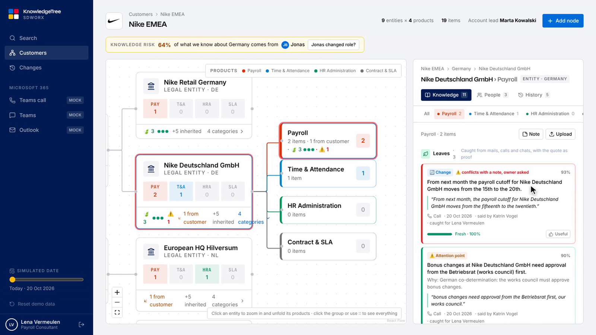

## Finals: Leaf a thought 🍃

SD Worx's extra challenge for the finals: *"Can your solution stay trusted without becoming another task?"*

Round 1 gave every customer a tree. The obvious question is who keeps that tree up to date. Our answer: **nobody has to.** The tree stays as it is, and **leaves** now grow on it: short pieces of working knowledge (a change, an attention point, a decision with its reason, a promise, expertise, a customer risk) that are caught from the work people already do.

**Principle: zero clicks when possible, one click when needed, never a form.**

| Scene | What happens | Shows |
| --- | --- | --- |
| 1. A call | Lena hangs up a call with Katrin (Nike Germany). Gemini transcribes it and catches three leaves on Nike Deutschland GmbH › Payroll: the cutoff moves to the 20th, the Betriebsrat must approve bonus changes, Jonas did that last year. A toast offers undo. | Zero clicks |
| 2. Teams | Lena reacts 🍃 to Sofie's tip. The message becomes a leaf on the right branch, with a link back to the chat. | One click when needed |
| 3. A conflict | The new cutoff contradicts Jonas's note (the 15th). Jonas, the owner, gets **one** card: Correct / Keep mine / Not sure. One tap and the note is version 3, with the call as its source. Katrin's mail the next day reconfirms it: ×2, no second leaf. | Humans only when judgement adds value |
| 4. Seasons | A time slider moves six months ahead. Leaves fade by type (a promise in weeks, expertise in a year), reconfirmed and "useful" leaves stay longer, fallen leaves move to an archive. Nothing is deleted. | No maintenance |
| 5. A role change | Knowledge risk on the customer: 62 % of what we know about Nike Germany comes from Jonas. When he changes role, KnowledgeTree suggests Lena from her real contributions, hands over his leaves and notes in one click and writes her a handover brief where every fact has its source. | Context isn't lost |

**Trust is built in.** Every leaf shows the exact quote it came from, the channel, who said it and how sure the model was. When the model is unsure it stores nothing; when it can't place a leaf, the leaf waits as a 🌱 seed at the customer. We read words, not voices: no personal facts about colleagues, no HR data, and every action checks that you're assigned to that customer.

| | |
| --- | --- |
| 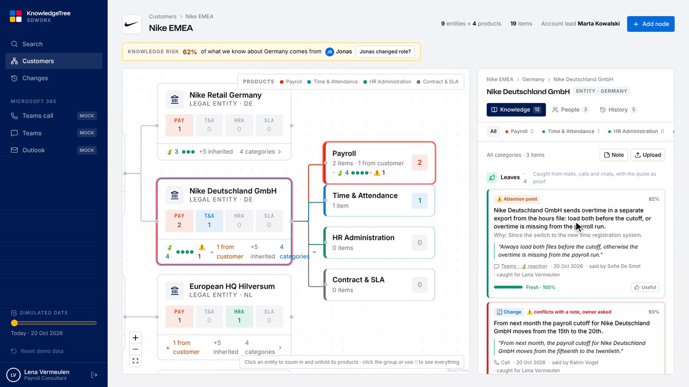 | 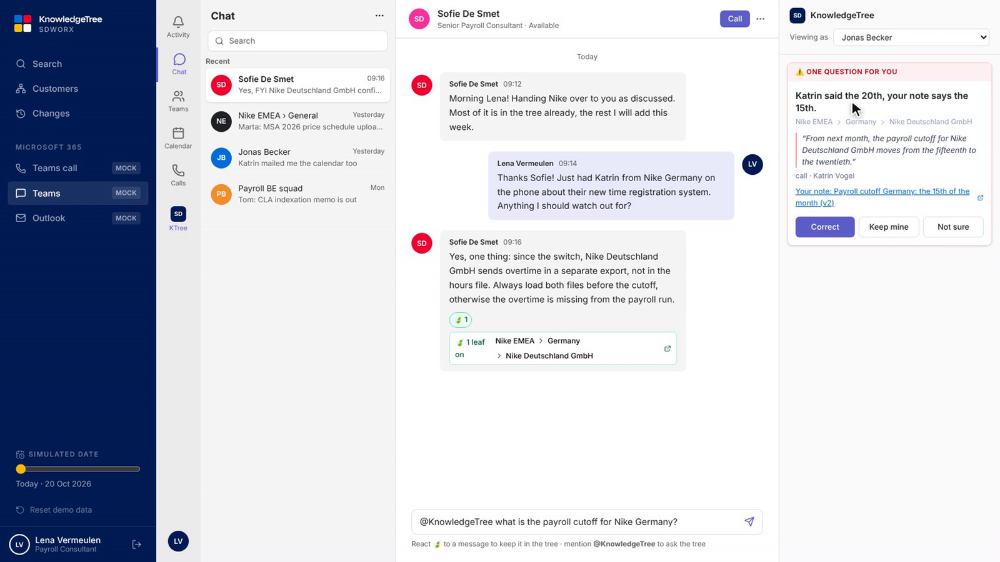 |
| 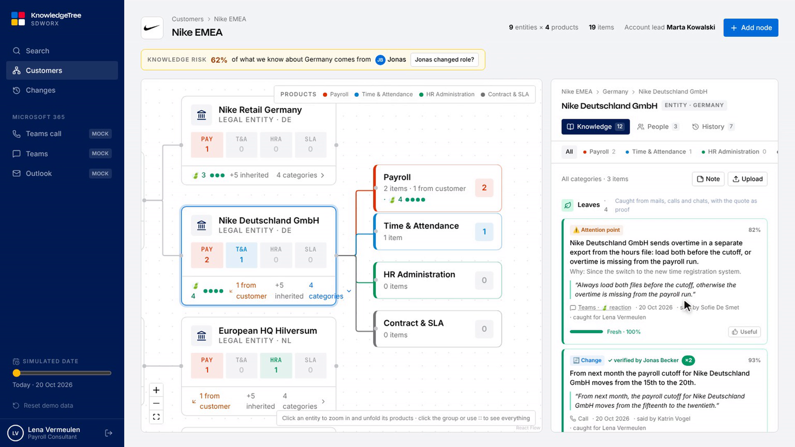 | 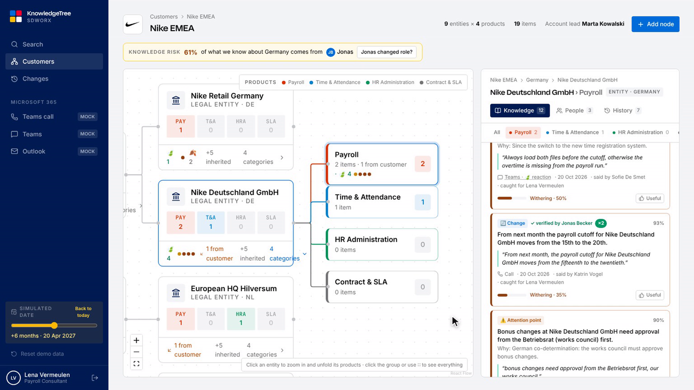 |
| 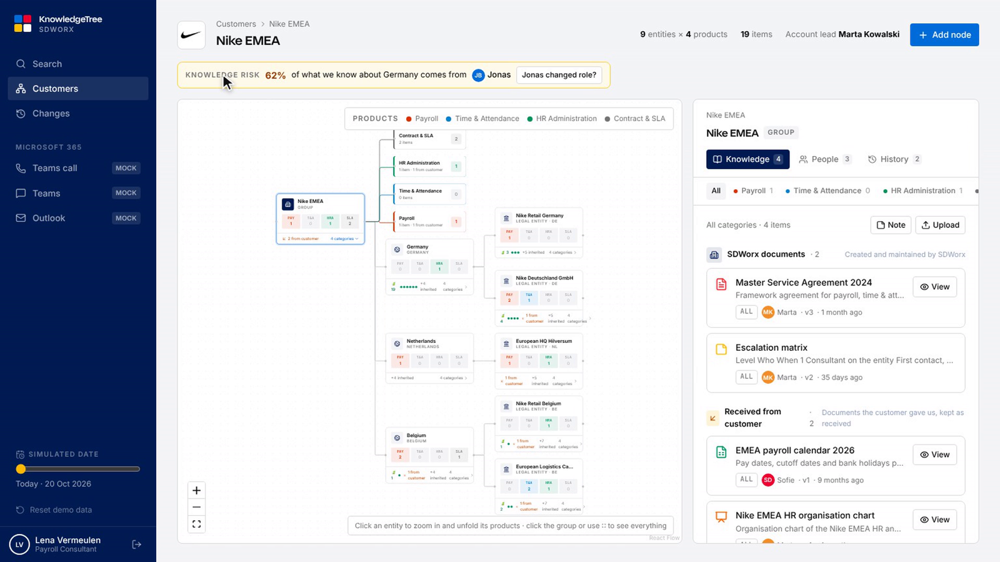 | 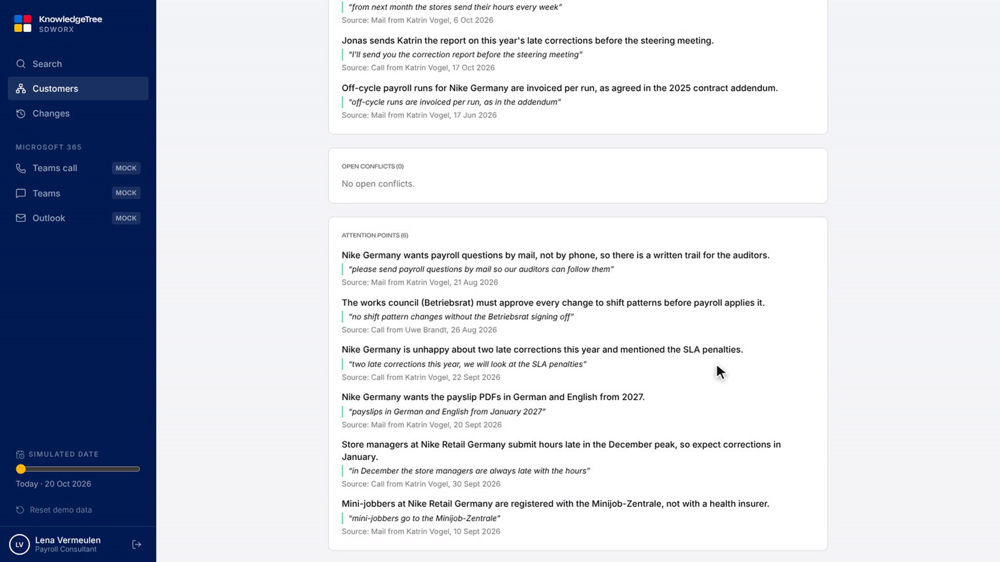 |

### How it works

Every channel (call, mail, Teams, and later a browser extension and voice notes) goes through one `ingest()` entry point. Gemini on Vertex AI, running as Cloud Run's own identity with no API keys, extracts 0–3 leaves with structured output and places them on a branch the user has access to. Each new leaf is compared with the leaves and notes on the same branch: new, reconfirmation or conflict. Freshness is computed when leaves are read, as an exponential decay by type, so the time slider costs nothing. If Vertex is slow or down, cached answers keep the demo running.

### Unfinished

- **Harvest digest:** the weekly two-minute page per branch owner (new, wilting, seeds to place, promotion to an official note) is designed but not built.
- **Browser extension and voice note:** designed as more channels into the same `ingest()`, not built.
- **Teams and Outlook** are mock-ups inside the portal that call the real backend, not real Microsoft 365 apps.
- **The demo call** is generated with Gemini text-to-speech. The demo runs on cached Gemini answers so every take is identical; live Vertex works too.
- **Data** lives in a JSON file inside the container, so Cloud Run runs one instance and **Reset demo data** restores the seed.

---

# Round 1: the tree

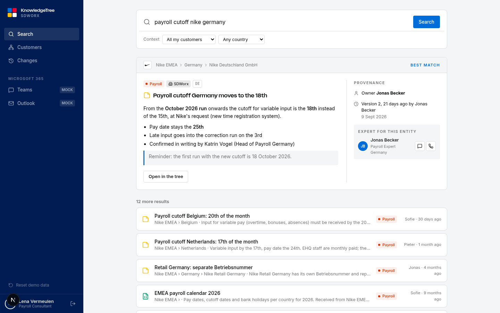

## The problem we picked

A payroll consultant at SDWorx works for several customers, each with entities in several countries. The knowledge about those customers is scattered: contracts in SharePoint, a payroll calendar in an email, the cutoff date in a Teams chat, the rest in the head of the colleague who is leaving. When a customer asks an urgent question, the consultant finds three versions of the answer and cannot tell which one is current, who changed it, or whether it even applies to this country.

Two moments of doubt from the challenge brief guided us:

- **The urgent question.** "Nike Germany asks what the payroll cutoff is, they heard it changed." Which document is right?
- **The client handover.** A consultant inherits a portfolio and has to rebuild the picture from folders, threads and people.

## Our idea

Instead of searching a pile of documents, we give every customer a **living organigram**: group, countries, legal entities. Every entity in that tree owns its own knowledge, so a fact always lives in exactly one place: the place it applies to.

Three rules make the knowledge trustworthy by construction, without a "trust score":

1. **Fixed shelves everywhere.** A customer subscribes to SDWorx products (Payroll, Time & Attendance, HR Administration, Legal & Compliance, Reporting, Contract & SLA). Every entity of that customer automatically carries the same product categories, even when empty. Nike Belgium and Nike Germany always have the same shelves, so nothing can hide in a random folder.
2. **Our documents and their documents are separate.** In every category, documents created by SDWorx are kept apart from documents received from the customer. What the customer sent is stored as received; what we wrote is versioned by us.
3. **Every change has a name.** Each file and note has an owner, a version history with a reason per version, and an audit trail. Outdated items are archived, never deleted, so history stays visible instead of competing with the current answer.

Around the tree we added the two things a consultant actually uses all day: a **search prompt** that answers with the entity, owner and version of the fact, and **capture from Teams and Outlook**, so knowledge leaves the inbox the moment it is created.

## What we built

A working web portal plus mock-ups of the Microsoft 365 integrations, all backed by the same data.

### Sign in and see only your customers

People only see the customers they are assigned to. Search, the tree, the Teams bot and the Outlook add-in all respect that, so the tree also protects customer data.

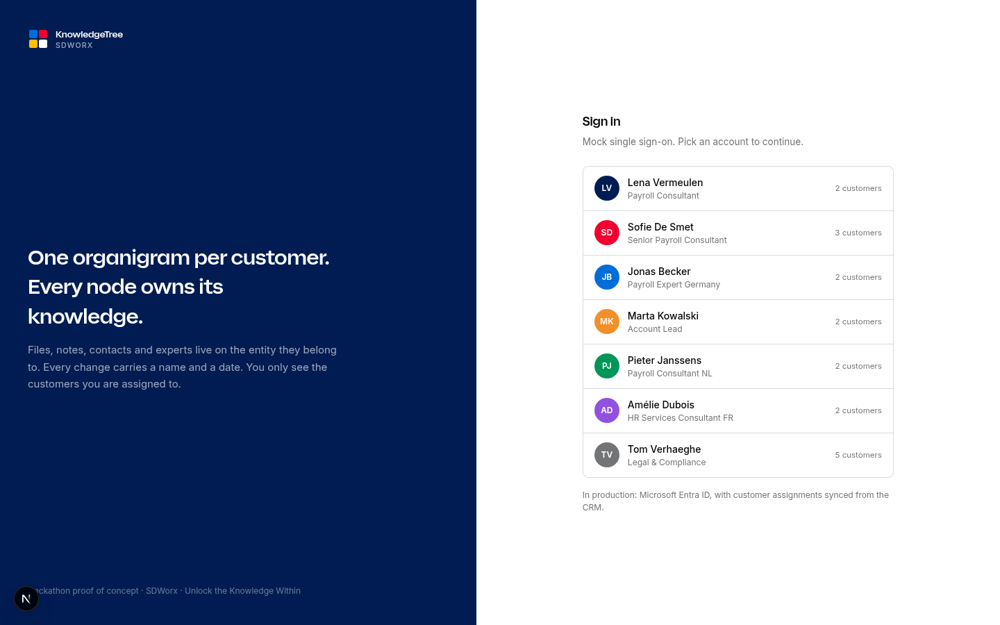

### Ask a question, get the fact with its provenance

The home page is a search prompt over your customers. The best match shows the entity it belongs to, the category, whether it is an SDWorx or a customer document, the owner, the version and the expert to call.

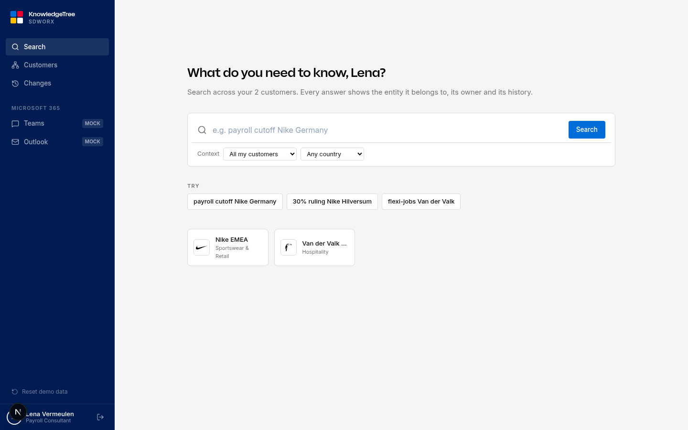

### Your customers

Customers with their products, countries, account lead and last change. Searchable and filterable.

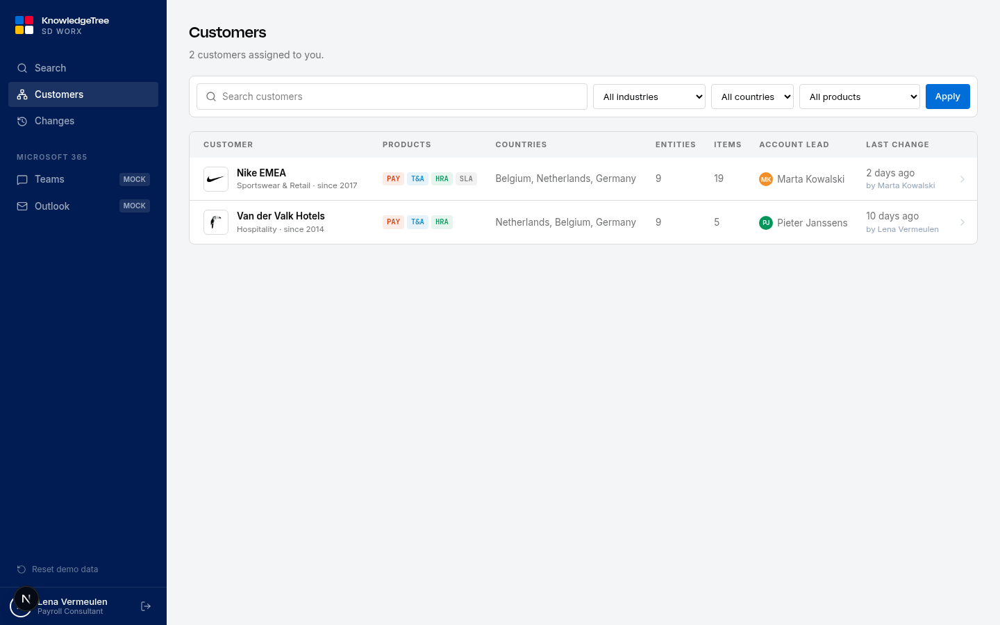

### The organigram

Every entity card shows the fixed product categories with item counts, how many documents came from the customer, and what it inherits from parent entities (a group agreement applies to every country below it). Click an entity and the view zooms in and unfolds its product nodes.

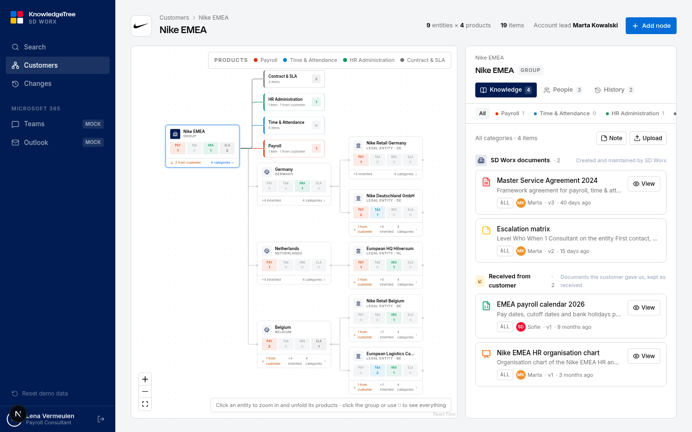

### An entity, one product, two kinds of documents

Nike Deutschland GmbH › Payroll: SDWorx notes on top, the Lohnsteuer registration received from the customer below. The note about the new cutoff renders as formatted text with its owner, origin, topic and full version history.

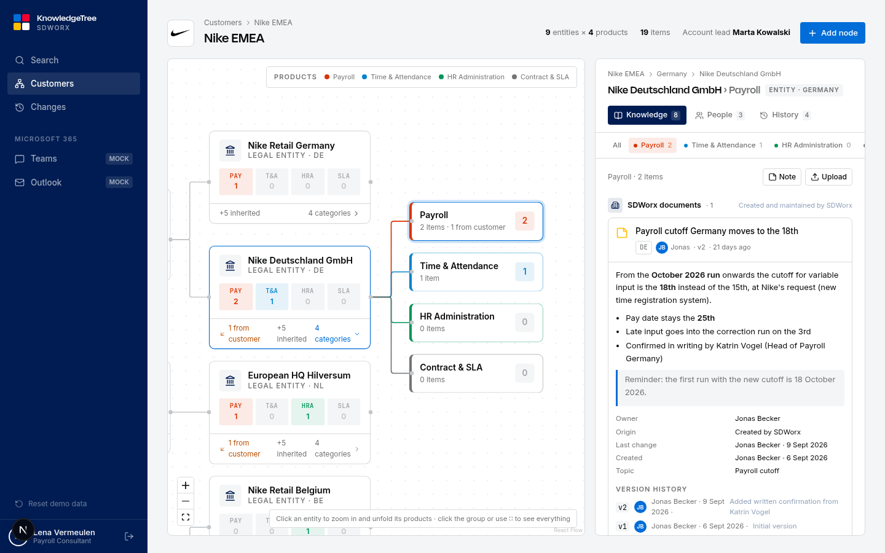

### Real documents: view and download

Every document opens in the portal (PDF, Excel and Word, with a PDF preview for Office files) and can be downloaded in its original format. New documents are uploaded from the same panel and get a new version each time a newer file is uploaded.

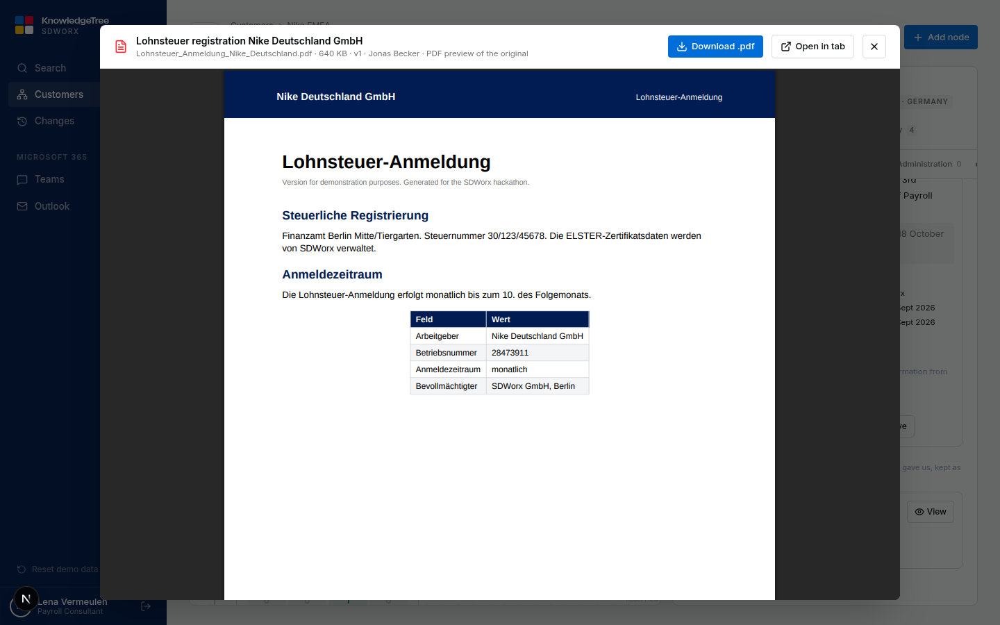

### Notes with a proper editor

Notes are written in a full-screen markdown editor with a toolbar and live preview. Saving asks for a reason, which lands in the version history.

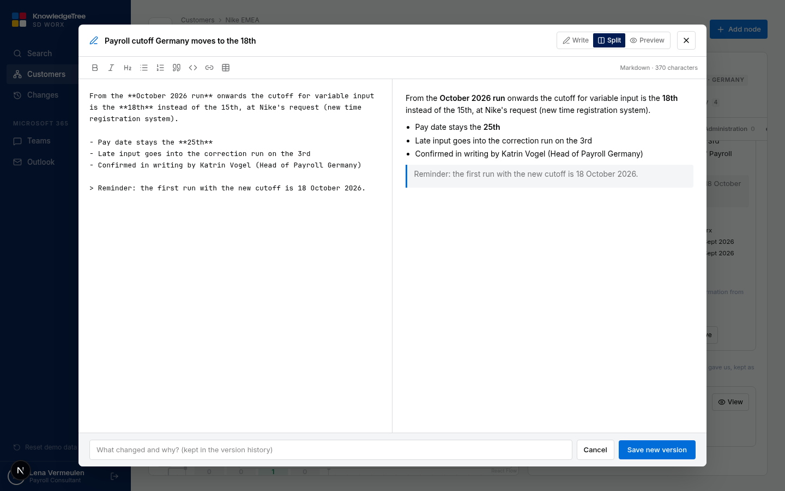

### Capture from Teams

In round 1, "Save to KnowledgeTree" stored a message on the right node. In the finals a 🍃 reaction replaces that dialog (see above). Mentioning @KnowledgeTree still asks the tree a question and gets the current fact with owner and version.

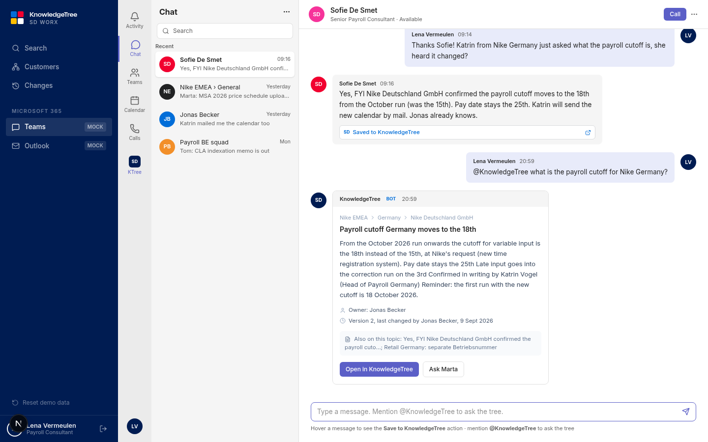

### Capture from Outlook

The add-in recognises the customer entity from the sender and the content and shows what the tree already knows. Since the finals, an opened mail is read automatically and its working knowledge becomes leaves with no click. Attachments can still be filed to the entity as documents received from the customer.

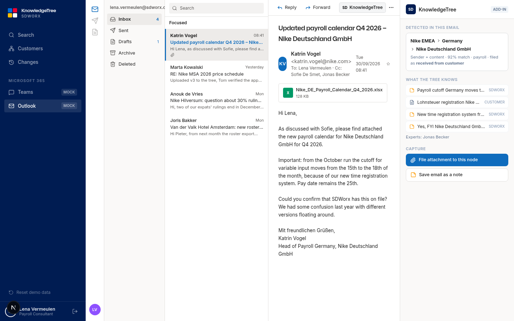

### Changes

Everything that changed on your customers, newest first, with a name on every line. Filter by customer or show only your own changes.

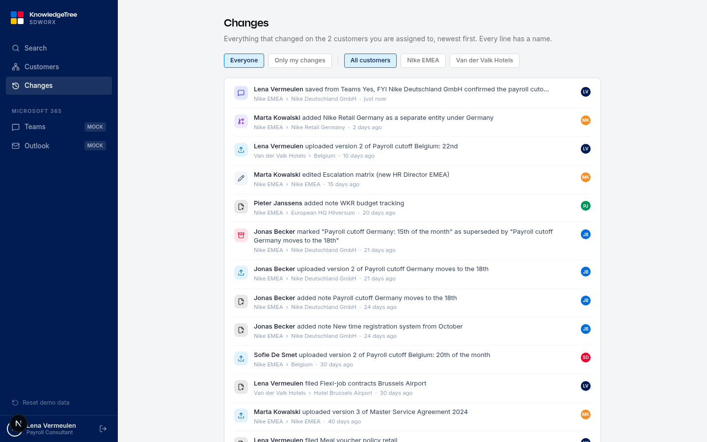

## Try the demo yourself

Sign in as **Lena Vermeulen** and press **Reset demo data** in the sidebar first. Then follow [`docs/demo/RUNBOOK.md`](docs/demo/RUNBOOK.md) scene by scene: Teams call › Call Katrin, Teams › 🍃 on Sofie's message, Teams › Viewing as Jonas › Correct, Outlook, the time slider, and Jonas changed role? on the Nike EMEA customer. Sign in as Amélie and Nike is gone.

## What is real and what is mocked

| Part | In this proof of concept | Production path |
| --- | --- | --- |
| Portal (search, customers, organigram, documents, notes, versions, history, access) | Fully working | Postgres or Firestore, files in Cloud Storage or SharePoint |
| Login | Mock single sign-on with an access list per person | Microsoft Entra ID, assignments from the CRM |
| Documents | Real generated PDF, Excel and Word files; real uploads | Connect to SharePoint / Graph API |
| Leaf extraction, placement and compare | Real Gemini on Vertex AI (structured output), with rule-based pre-filter and cached answers as fallback | Same, with a production quota |
| Call transcription | Real Gemini on Vertex AI; the call itself is a generated two-voice recording | Teams call recording or telephony integration |
| Freshness, conflicts, knowledge risk, handover | Fully working | Same |
| Teams message action, 🍃 reaction and bot | Mock Teams client inside the portal, calling the real backend | Teams message extension and Bot Framework app |
| Outlook add-in | Mock Outlook inside the portal, calling the real backend | Office add-in manifest, Graph API for mail and attachments |
| Browser extension, voice note, harvest digest | Not built | Same `ingest()` entry point |

## Team

VIVES student team for the SDWorx hackathon 2026.

---

## Technical details

### Run locally

```bash
pnpm install
pnpm dev
# open http://localhost:3000 and pick an account
```

Data lives in `data/db.json`, created from the seed on first start. **Reset demo data** in the sidebar restores the seed. Uploads land in `data/uploads`.

Tests: `pnpm test` (vitest).

The session cookie is signed with `SESSION_SECRET` (see `.env.example`). Locally a dev-only fallback is used; in production set it (for Cloud Run: `--set-env-vars SESSION_SECRET=$(openssl rand -hex 32)`), otherwise a random per-instance secret is used and everyone is signed out on restart.

### Stack

Next.js 16 (App Router, server actions, route handlers), React 19, Tailwind 4, React Flow with dagre for the organigram, react-markdown for notes. Branding follows the SDWorx Ignite design system (cdn.sdworx.com/ignite): primary blue #006dd8, dark navy #001c52, logo red and yellow, Inter for body text and SD Worx Display for headings. Tokens are in `src/app/globals.css`, the product catalog in `src/lib/catalog.ts`.

### Project layout

| Path | What |
| --- | --- |
| `src/app` | Pages: search (`/`), customers, customer tree, changes, login, Teams and Outlook mock-ups, file API |
| `src/components` | Organigram, node panel, document viewer, note editor, mock-ups |
| `src/lib` | Data model, seed, JSON store, search, node detection, server actions, auth |
| `assets/files` | Generated demo documents (PDF, XLSX, DOCX) and their PDF previews |
| `public/logos` | Customer logos |
| `scripts/generate_files.py` | Regenerates the demo documents (needs Python with reportlab and openpyxl, plus LibreOffice) |
| `docs/screenshots` | The images in this README |

### Deploy on Google Cloud (Cloud Run)

The app ships as one container (`Dockerfile`, Next.js standalone build). Cloud Run builds it from source and returns a public HTTPS URL.

```bash
gcloud auth login
gcloud config set project YOUR_PROJECT_ID
gcloud services enable run.googleapis.com cloudbuild.googleapis.com artifactregistry.googleapis.com

gcloud run deploy knowledgetree \
  --source . \
  --region us-east1 \
  --allow-unauthenticated \
  --memory 1Gi \
  --min-instances 1 \
  --max-instances 1 \
  --set-env-vars SESSION_SECRET=$(openssl rand -hex 32)
```

**Gemini (leaves).** Leaf extraction calls Gemini on Vertex AI as the Cloud Run service account, so there is no API key. Enable the API, give the runtime service account `roles/aiplatform.user` and pass the project on deploy:

```bash
gcloud services enable aiplatform.googleapis.com
gcloud projects add-iam-policy-binding YOUR_PROJECT_ID \
  --member "serviceAccount:$(gcloud projects describe YOUR_PROJECT_ID --format='value(projectNumber)')-compute@developer.gserviceaccount.com" \
  --role roles/aiplatform.user
# extend the --set-env-vars list of the deploy command with:
#   ,GOOGLE_CLOUD_PROJECT=YOUR_PROJECT_ID,GOOGLE_CLOUD_LOCATION=us-east1,GEMINI_MODEL=gemini-3.5-flash,GEMINI_FALLBACK_MODEL=gemini-2.5-flash
```

If Vertex is unreachable or slow, ingest answers from cached responses keyed on the input text (`src/lib/gemini-cache.json` for the demo flows, regenerated by `node scripts/demo-cache.mts`), so the demo keeps working.

Re-run the same command to redeploy. `--min-instances 1` keeps one instance warm for the pitch. Data and uploads live inside the container, so they reset when Cloud Run replaces the instance; press **Reset demo data** before the demo. Local container check: `pnpm docker:build` then `pnpm docker:run` (http://localhost:8080).
